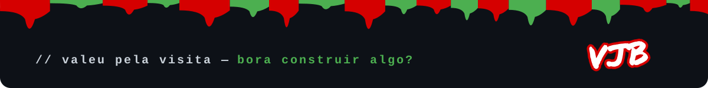

<h3><code>01</code>&nbsp; Sobre</h3>

```kotlin
object Vinicius {
    val cargo  = "Desenvolvedor Mobile & Back-end"
    val mobile = listOf("Android · Kotlin · Jetpack Compose", "iOS · Swift · SwiftUI")
    val api    = "Ktor — uma API única, compartilhada entre todas as plataformas"
    val web    = listOf("React + TypeScript (PWA)", "Laravel / PHP")
    val ia     = listOf("Claude Code", "GitHub Copilot")
    val foco   = "código limpo · arquitetura que escala · do zero à produção"
}
```

<h3><code>02</code>&nbsp; IA no meu fluxo de trabalho</h3>

- **Planejamento** — arquitetura, infraestrutura e decisões técnicas discutidas com agentes de IA antes da primeira linha de código.
- **Desenvolvimento** — Claude Code e GitHub Copilot como par de programação.
- **Revisão e testes** — revisão de código, segurança e testes automatizados assistidos por IA.
- **Critério** — a IA acelera; toda linha passa pela minha revisão.

<p>
  
  
</p>

<h3><code>03</code>&nbsp; Stack</h3>

<p>
  <br/>
  <br/>
  
</p>

<h3><code>04</code>&nbsp; Agora</h3>

Construindo um produto próprio de ponta a ponta: **apps nativos**, **API em Ktor**, **web/PWA** e **infraestrutura em nuvem**.

<h3><code>05</code>&nbsp; Contato</h3>

<p>
  <a href="mailto:vini.jbaroni@gmail.com"></a>
  <a href="https://www.linkedin.com/in/vin%C3%ADcius-j-baroni"></a>
</p>


