<p align="center">
  
</p>

<h3 align="center">👾 Quem sou eu</h3>

```kotlin
object Vinicius {
    val cargo  = "Desenvolvedor Mobile & Back-end"
    val mobile = listOf("Android · Kotlin · Jetpack Compose", "iOS · Swift · SwiftUI")
    val api    = "Ktor — uma API única, compartilhada entre todas as plataformas"
    val web    = listOf("React + TypeScript (PWA)", "Laravel / PHP")
    val ia     = listOf("Claude Code", "GitHub Copilot")
    val foco   = "código limpo · arquitetura que escala · do zero à produção"
}
```

<h3 align="center">🤖 IA no meu fluxo de trabalho</h3>

- 🧠 **Planejamento:** arquitetura, infraestrutura e decisões técnicas discutidas com agentes de IA antes da primeira linha de código.
- ⚡ **Desenvolvimento:** agentes de código (Claude Code) e GitHub Copilot como par de programação.
- 🔍 **Revisão e testes:** IA para revisar código, caçar falhas de segurança e escrever testes automatizados.
- 🧑‍✈️ **Regra de ouro:** a IA acelera, mas toda linha passa pela minha revisão.

<p align="center">
  
  
  
</p>

<h3 align="center">🛠️ Arsenal</h3>

<p align="center">
  <br/>
  <br/>
  
</p>
<p align="center">
  
  
  
</p>

<h3 align="center">🔭 Agora</h3>

<p align="center">
  Construindo um produto próprio de ponta a ponta: <b>apps nativos</b>, <b>API em Ktor</b>, <b>web/PWA</b> e <b>infraestrutura em nuvem</b>.
</p>

<h3 align="center">📊 Status</h3>

<p align="center">
  
  
</p>
<p align="center">
  
</p>

<h3 align="center">📫 Bora conversar?</h3>

<p align="center">
  <a href="mailto:vini.jbaroni@gmail.com"></a>
  <a href="https://www.linkedin.com/in/vin%C3%ADcius-j-baroni"></a>
</p>


